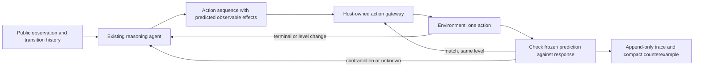

# Stage 3 research: prediction checks without a mandatory world model

Research snapshot: **26 October 2026**. Status: **proposal, not implemented or benchmarked**.

**Recommendation:** reproduce Daniel Franzen’s released Milestone 2 configuration, then test one change: require a prospective, executable check before continuing a multi-action sequence. Stop the sequence when its predicted effect is contradicted or cannot be evaluated. Keep the model, serving stack, perception tools, rolling context, retained functions, and scheduler fixed.

This is a selective adaptation of an existing prediction-checking technique, not a claim to have invented world models or verification. Its potential advantage is catching **wrong-but-changing actions** without paying for a complete simulator. Confidence that it will improve competition score is **low to moderate**. The first experiment must establish whether this failure occurs often enough in the released baseline to justify the intervention.

## A. Comparative analysis

### Separate the evaluation settings

The 25 downloadable demonstration games are not the Kaggle public leaderboard set. Competition data documentation describes **110 hidden evaluation games**, split between public and private leaderboard scoring. “Public-game result” and “public leaderboard score” therefore refer to different tests. The live leaderboard confirms an approximately 50/50 split. [Competition data](https://www.kaggle.com/competitions/arc-prize-2026-arc-agi-3/data), [leaderboard](https://www.kaggle.com/competitions/arc-prize-2026-arc-agi-3/leaderboard).

| Evidence inspected | Result and setting | What can reasonably be concluded |
|---|---|---|
| Current Kaggle leaderboard, read directly | Yi-Chia Chen @ Fields Model **71.48**, Tufa Labs **68.91**, Team Turducken **56.02**; Daniel Franzen **38.85**, rank 16 | These are current team results. I did not establish a public source/configuration mapping for these latest submissions. Do not attribute them to the older released harnesses. |
| Original Duck release | Published demonstration experiment: 25 games × 20 attempts, mean **1.6002**, 0/500 complete wins; Qwen3.6-27B-FP8 | Inspectable early experiment, not evidence that the current Tufa system scores 1.6 or that this is its latest architecture. |
| Franzen published notebook, version 3 | Notebook UI: **33.68**, best **34.30 V1**. Its saved demonstration output: **46.49**, **33/100** complete playthroughs, 25 games × 4 passes | Strong, accessible offline reproduction target. Demonstration score, notebook submission score, current team score, and the write-up’s historical **27.89** must remain separate. |
| Kepler frozen public release | Reports **100% RHAE** for its Opus configuration on final public-game replay segments | Evidence that recorded solutions replay successfully; explicitly not first-exposure efficiency, hidden-game performance, or Kaggle eligibility. |
| Rodionov controlled coding-agent study | Four nested architectures on public games; follow-up verification variant reports approximately **99%**, all games solved | Useful architectural evidence, but stronger proprietary models, substantially different resource use, and no hidden-set qualification. |

Sources: [Duck technical discussion](https://www.kaggle.com/competitions/arc-prize-2026-arc-agi-3/discussion/717133), [Duck run summary](https://github.com/Tufalabs/duck-harness/blob/7652836056c59e044f093e3c13ed7438c814169e/example-run/summary.txt), [Franzen notebook](https://www.kaggle.com/code/dfranzen/arc-agi-3-milestone-2-solution), [Kepler evidence boundaries](https://github.com/Cveinnt/kepler/blob/9fc5b108e9d285b0b10fdc79ea8ffeba3a7df37e/docs/evidence-boundaries.md), [Rodionov paper](https://arxiv.org/html/2607.15439v1).

The current competition Code page also contains numerous Franzen derivatives and other agents. Examples observed include *ARC3 M2 Solution v3* at 32.60 and a Franzen fork at 30.74. Notebook names, votes, and scores do not establish an architectural advance; I did not treat these forks as independent evidence. [Current notebooks](https://www.kaggle.com/competitions/arc-prize-2026-arc-agi-3/code).

### Duck: flexible coding instead of a prescribed solver

**Architecture.** A multimodal model receives the latest rendered grid and can inspect ASCII, connected components, containment and adjacency through Python. It gets explicit before/action/after transitions, legal actions, and outcome metadata. It generates Python that can inspect, search, and execute batches; the tool refreshes observation variables after actions. The Python namespace is recreated between calls. Conversation history and extracted textual world-model notes provide persistence; an executable simulator is possible but not required. The model chooses its own probes and plans. Level/reset feedback asks it to re-ground its interpretation. [Prompts](https://github.com/Tufalabs/duck-harness/blob/7652836056c59e044f093e3c13ed7438c814169e/ARC3-Inference/inference/agent/prompts.py), [agent implementation](https://github.com/Tufalabs/duck-harness/blob/7652836056c59e044f093e3c13ed7438c814169e/ARC3-Inference/inference/agent/tool_agent.py).

**Strengths and evidence.** This gives a coding model familiar tools without forcing every game into one ontology. The authors identify model quality and multimodal input as the main practical gains, while reporting that additional handcrafted tools did not help. These are development observations, not a comprehensive controlled ablation. The original technical discussion describes missing animation information, board dumps overwhelming context, and mistaken interpretations of interface elements. These are reported failures, not merely hypothetical risks. [Technical discussion](https://www.kaggle.com/competitions/arc-prize-2026-arc-agi-3/discussion/717133).

**Limits.** Same-color connected components are visual regions, not guaranteed game entities; the original prompt even overstates the identity significance of equal shape hashes. A long action program can continue under an incorrect interpretation unless the generated code checks its assumptions. Rolling eviction and free-text note extraction can lose or preserve the wrong evidence. Some of these weaknesses are subsequently addressed by Franzen; they should not be assigned unchanged to his release.

**Reproducibility.** Source, notebook, run configurations, and extensive traces are public. The example configuration identifies a two-server Slurm experiment with 64 effective concurrent jobs, not a matched single-Kaggle-GPU comparison. The repository also supports external providers; only the offline local-model path is relevant here. [Run configuration](https://github.com/Tufalabs/duck-harness/blob/7652836056c59e044f093e3c13ed7438c814169e/example-run/run_config.json).

### Franzen: improve useful reasoning per GPU-hour

**Architecture.** This is a Duck descendant, not an independent reasoning paradigm. The published notebook adds:

- Qwen3.8-Flash-Next, Intel W4A16 AutoRound weights, a separate speculative draft model, and a patched SGLang runtime.
- A 131,072-token harness context, 12,288-token maximum output, blockwise history removal, and preserved reasoning history. Ten active streams and cache-aware scheduling manage contention.
- Larger current-grid images, difference/death images, optional inspection of intermediate animation frames and timelines, and more precise action-result histories.
- Game-scoped retention of eligible Python functions/imports. Ordinary tool variables are still transient. Mechanics and helpers can transfer between levels, but prompts explicitly require checking new goals and interactions.
- No-op batch interruption, stale-state protection, and terminal/level-boundary protection. These preserve the fatal observation before recovery rather than confusing the reset frame with the action’s effect.

These settings were checked against the **downloaded version-3 notebook**, not inferred from every option in the repository. Its structured world-model sections are **off**. Periodic summarization and remembered no-op/death guards are not part of the selected configuration. The stale-state threshold is level 2; the batch and terminal guards are separate from that threshold. [Notebook](https://www.kaggle.com/code/dfranzen/arc-agi-3-milestone-2-solution), [sandbox execution](https://github.com/da-fr/arc-agi-3-solution/blob/10882e332d883af3e61616df8c8a17d03a328a75/ARC3-Inference/inference/agent/python_tool_sandbox.py), [level-transfer prompts](https://github.com/da-fr/arc-agi-3-solution/blob/10882e332d883af3e61616df8c8a17d03a328a75/ARC3-Inference/inference/agent/prompts.py).

**What improves what?** Stronger weights change capability. Quantization, speculative decoding, prefix caching and admission control change the quantity of reasoning possible within nine hours. Perception fixes change available evidence. Recovery and action guards change execution. The published gains bundle these factors; there is no clean evidence that a new reasoning strategy alone explains the score increase. The scheduler estimates continuation value from observed progress and resources consumed; it is not a calibrated model of a game’s solvability. [Scheduler](https://github.com/da-fr/arc-agi-3-solution/blob/10882e332d883af3e61616df8c8a17d03a328a75/ARC3-Inference/inference/agent/priority_scheduler.py), [serving reproduction](https://github.com/da-fr/arc-agi-3-solution/blob/10882e332d883af3e61616df8c8a17d03a328a75/serving/README.md).

**Important negative evidence.** Franzen reports that disabling structured world-model updates worked best with the larger context. Summarization, stronger step-verification wording, additional state/death guards, and automatic animation insertion had unclear or negative value. Those results are not sufficiently controlled to settle the questions, but they strongly argue against adding a large memory subsystem or more instructions by default. [Write-up, sections 5–6](https://github.com/da-fr/arc-agi-3-solution/blob/10882e332d883af3e61616df8c8a17d03a328a75/WRITEUP.md#6-what-did-not-clearly-improve-the-score).

**Concrete limitations.** `gameplay_changed` ignores a four-cell border; it is a geometric heuristic, not a semantic progress detector. A wrong action that moves an interior object passes that test. Separately, an optional guard’s source documents an earlier interaction producing 291 replies but only one executed action; that experimental guard defaults off. This supports caution about blocking, not a claim that the released notebook has that bug. [Guard implementation and rationale](https://github.com/da-fr/arc-agi-3-solution/blob/10882e332d883af3e61616df8c8a17d03a328a75/ARC3-Inference/inference/agent/noop_repeat_guard.py).

The notebook’s saved outputs show substantial remaining variation: SK48 completed zero levels in all four passes; SP80 completed 1, 1, 2, and 3 of 6 levels; VC33 won three passes and reached 3/7 in the other. These outcomes establish failures and variance, **not their causes**. In particular, no evidence yet establishes that unwanted batch continuation dominates this baseline’s losses. Its recorded benchmark took 8h10m56s; complete notebook runtime was 8h21m48s. [Version-3 outputs](https://www.kaggle.com/code/dfranzen/arc-agi-3-milestone-2-solution).

### Kepler: an executable scientific-method workflow

**Architecture.** A coding agent observes numeric grids and animations, writes `world_model.py`, tests it against recorded history, searches inside it, and sends plans through a prediction-checking executor. Durable notes distinguish checked claims from assumptions; code and artifacts survive model sessions. The model contract includes next-state and terminal predictions, with optional latent state and goal/action helpers. Learning is followed by certification and mechanical execution of per-level programs. This is substantially different from letting a REPL agent choose whether to construct a model. [Design](https://github.com/Cveinnt/kepler/blob/9fc5b108e9d285b0b10fdc79ea8ffeba3a7df37e/DESIGN.md), [model template](https://github.com/Cveinnt/kepler/blob/9fc5b108e9d285b0b10fdc79ea8ffeba3a7df37e/harness/ws_tools/world_model_template.py).

**Strengths.** Predictions produce concrete counterexamples; history replay can detect regressions in a revised model; searches can run without consuming environment actions. Persistent model code supports cross-level reuse. An independently owned event ledger provides useful provenance. These mechanisms are implemented, but implementation is not causal evidence of better scores.

**Limits verified in source.** The execution tool stops on prediction mismatches, but prediction exceptions and zero pixel coverage can allow execution without verification. Its default BFS is explicitly unsuitable for combinatorial games. A precise simulator can still encode the wrong goal, omit hidden state, or fit observations through overly specific rules. Those last possibilities are risks, not measured prevalence. [Execution code](https://github.com/Cveinnt/kepler/blob/9fc5b108e9d285b0b10fdc79ea8ffeba3a7df37e/harness/ws_tools/commit.py#L421).

**Evidence boundary.** The repository retracts its harness-versus-bare-agent ablation: all six controls accessed and reconstructed the harness. A separate source-reading incident invalidated an earlier perfect run. Neither incident automatically invalidates the independently audited release boards, but the ablation cannot support a causal harness advantage. The release clarification also distinguishes final replay actions from learning cost and estimates $777.72 from retained Opus usage, not total research spending. Proprietary CLI/API inference and the learning/replay protocol make this an architectural reference, not a Kaggle-ready baseline. [Retracted ablation](https://github.com/Cveinnt/kepler/blob/9fc5b108e9d285b0b10fdc79ea8ffeba3a7df37e/ABLATION.md), [evidence boundaries](https://github.com/Cveinnt/kepler/blob/9fc5b108e9d285b0b10fdc79ea8ffeba3a7df37e/docs/evidence-boundaries.md).

### Rodionov: direct evidence against “a simulator must help”

The study compares textual memory, executable modeling, added simplification, and a fixed-interface verification treatment. Stronger models and reasoning effort improved every variant. Textual modeling beat the flexible executable variant in both GPT-5.5 settings. Verification ranked first across the four main model/effort settings, but consumed substantially more resources and also changed interfaces/templates. It is not an equal-budget isolation of verification. Each game has only one playthrough per main condition, so variability remains material. [Study and resource tables](https://arxiv.org/html/2607.15439v1).

The inspected controller handles level changes, deaths, stalled action counts, and simplification prompts. The verification prompt separates dynamics, initial-state reconstruction, and rendering, requires replay of settled observations, and permits intermediate frames as evidence. Textual agents retain mechanics and level reports without a mandatory simulator. Both use external Codex inference; neither is directly an offline Kaggle solution. These source differences make the study more informative than comparing unrelated headline scores. [Controller](https://github.com/astroseger/arc-3-agents-baseline1/blob/ef104f198adf2ad2a3506638dc21d0249eb8308c/papers/paper02/agents/ewma_sv_v1.2/src/agent/agent.py), [verification contract](https://github.com/astroseger/arc-3-agents-baseline1/blob/ef104f198adf2ad2a3506638dc21d0249eb8308c/papers/paper02/agents/ewma_sv_v1.2/src/agent/prompts/main_prompt.md), [textual contract](https://github.com/astroseger/arc-3-agents-baseline1/blob/ef104f198adf2ad2a3506638dc21d0249eb8308c/papers/paper02/agents/twma_v1.2/src/agent/prompts/main_prompt.md).

## B. Bottleneck diagnosis

Our Stage 2 evidence is unusually clean about one narrow issue. Across 25 games, three policy seeds and 256 actions per run, Legal Random reduced repeats from **43.2% to 28.4%** and no-change actions from **36.3% to 17.3%**, yet completed no games. Memory had **30.4%** repeats and also no wins. The sums of maximum levels reached were 3, 2, and 2 respectively, not distinct solved-game counts. [Local comparison](/Users/xiyuanpan/ARC-AGI-3-Kaggle-Starter/docs/stage2-comparison.md), [protocol and reproducibility](/Users/xiyuanpan/ARC-AGI-3-Kaggle-Starter/docs/stage2-exploration.md).

This rejects observation novelty as a sufficient objective under that budget. It does **not** compare reasoning models, diagnose their perception, or show that all model-free exploration is futile.

| Candidate bottleneck | Assessment | Confidence and limits |
|---|---|---|
| Model capability | A major determinant: interpreting an unfamiliar scene and producing useful code remain model-dependent | **High** that it matters; not quantified for our untested reasoning baseline |
| Causal inference, goal discovery, hypothesis verification | Local changes must be integrated into rules and a goal; more diverse pixels do not supply that integration | **Moderate–high** as a general problem, **moderate** for current open-weight competition agents |
| Perception/state representation | Object grouping, animation evidence, and HUD confusion materially affect what can be inferred | **High** that defects occur; evidence does not show perception is the single dominant limit |
| Experimental design | Actions should discriminate plausible mechanics or advance an evidenced plan, rather than maximize novelty | **Moderate**; no matched experiment here establishes formal information gain as the best selector |
| Planning/execution | A valid interpretation can still fail through stale or overlong action programs | **Moderate**; baseline guard code exposes a concrete gap, but its frequency is unmeasured |
| Memory/context | Useful evidence must survive, but rigid summaries can preserve errors and consume budget | **High** that naive added memory is not reliably helpful; **low** that more structure is the main missing component |
| Compute allocation | Throughput, cache retention, and time across games directly constrain opportunity to reason | **High** operational importance; more complex scheduling has not earned priority over a proven stack |

Independent ARC Prize analysis of 160 replays describes correct local observations that never become usable global rules, inappropriate familiar-game analogies, and poor transfer after an early success. It supports the causal/goal diagnosis, but its GPT-5.5 reasoning analysis used a different “analysis mode” from official scoring. It neither proves explicit world models are necessary nor estimates today’s Franzen failure distribution. [ARC Prize trajectory analysis](https://arcprize.org/blog/arc-agi-3-gpt-5-5-opus-4-7-analysis).

**Working diagnosis:** the broad challenge is converting evidence into a useful, revisable interpretation. The smallest tractable intervention this week is narrower: stop spending actions after an interpretation has already been contradicted. This does not solve goal discovery, and it may have little effect on games stalled before any useful plan exists.

## C. Proposed architecture

### Franzen baseline plus prospective checks on continued execution

Keep one multimodal coding agent. Add no separate critic, hypothesis ensemble, learned dynamics model, or mandatory world-model file.

**The single changed contract:** continuing beyond the first real action in a Python snippet requires a check, specified before the action, of the observable effect on which the continuation depends. It applies to lists and repeated calls inside loops. An unverified exploratory action remains possible; its snippet yields before a second action. Existing terminal and no-op guards remain unchanged.

1. The model selects legal actions and, where it wants to continue without another model turn, specifies expected values for a small observable feature: a selected region’s contents, an object’s position/orientation, or another feature derived from the public frame. Expectations are frozen before execution. A statement that “something changed” is insufficient.
2. A bounded, read-only Python extractor evaluates that feature on the returned observation. It has no action, file, network, or mutation access. The host compares the result with the stored expectation; the model cannot rewrite the expectation after seeing the response.
3. A match permits the next action. A contradiction or extraction ambiguity stops the remaining sequence and returns a compact counterexample to the same model. Missing predictions, timeouts and checker errors are **unknown**, not successful verification.
4. The next model turn can revise its rule, inspect available animation frames, or make one unverified probe. There is no permanent forbidden-action list. Reissuing a refuted sequence requires a new model turn and leaves an auditable record.

This permits checks cheaper than a simulator: predicting a tracked object’s displacement does not require rendering the entire next frame. It also permits predictions of no visible change where appropriate; passing such a check does not establish progress or unchanged hidden state. Level completion and game victory come only from environment metadata.

**Memory.** Retain Franzen’s conversation and function persistence. Add only host-owned records of the contract, feature scope, source transition, expected/actual values, verdict, and skipped actions. Inject the latest unresolved counterexample; retain its evidence ID across context pruning until revision or explicit abandonment. Store raw evidence in the existing local trace format through an adapter, without changing Stage 1 records. No global theory database or periodic model-written summaries.

**Level and reset semantics.** Checks are scoped to the game, level, attempt and action sequence. Cancel them on death, reset or level transition. Retain helper source as the baseline already does, but never carry a successful check forward as proof about a new level. Evaluate settled frames by default; permit an explicitly declared intermediate-frame feature when needed. Ambiguous object correspondence yields unknown, rather than treating a shape hash as identity.

**What is actually different?** Duck already requests discriminating probes, Franzen already supports custom checking code, and Kepler already checks predicted transitions. The intervention is **host-enforced, prospective checks for continued batching, without requiring a persistent simulator or replaying all history**. Its proposed novelty is the constrained integration and cost tradeoff relative to the selected baseline, not a new general reasoning principle. Whether making this mandatory helps is precisely what must be tested.

## D. Improvement hypothesis

> With identical model weights, serving configuration, game/seed pairs, and resource ceilings, prospective checks on continued execution will increase mean official ARC score over Franzen’s released configuration by reducing actions taken after an observable contradiction, while preserving inexpensive execution of correctly predicted sequences.

**Causal expectation:** a no-op guard misses an action that changes the board in the wrong way. A prospective check can catch that before the rest of the plan executes. Returning the exact mismatch may support revision better than a general instruction to verify. This extrapolates from implemented prediction checking and observed integration failures; it is not an established performance result.

**Cost:** prediction text/code, CPU extraction, extra model turns on mismatches or missing checks, context pressure, and possible lost prefix-cache efficiency. There is no extra LLM call solely to judge a check.

**Preregistered practical target:** at least **+2 absolute ARC score points** on the validation games, with no reduction in completed games, and at least **20% fewer post-contradiction continuation actions** where such events occur. These are decision thresholds, not predicted effect sizes. Report uncertainty and results below the thresholds rather than retuning them afterward.

**Falsification:** the proposed improvement is unsupported if score does not improve at the common budget, if gains disappear against a single-action control, or if prediction-only logging achieves the same gain. Its causal account is weakened if apparent improvements occur without fewer contradicted continuations. If the baseline audit finds these events rare, reject this proposal before building a larger system.

## E. Risks and tradeoffs

| Risk | Consequence and bounded response |
|---|---|
| Goal hypothesis is wrong but predictions are accurate | Checks confidently execute the wrong task. Official progress remains the outcome; do not equate prediction accuracy with solving. |
| Weak or tautological predictions | High pass rate with no useful coverage. Record the feature and expected effect; audit specificity, not just pass percentage. |
| Hidden state, animations, scrolling, merged objects | False contradictions and repeated replanning. Preserve raw responses; unknown checks permit a fresh single-step probe instead of permanently blocking the action. |
| Necessary long sequences or waiting actions | More model calls can consume the nine-hour budget. The single-action ablation reveals whether guard overhead outweighs batching benefits. |
| Extra prose recreates Franzen’s negative verification result | No score improvement despite plausible reasoning. Keep one small contract and stop after the preregistered experiment. |
| Agent bypasses or modifies verification | Invalid treatment. Keep the action gateway and ledger outside the agent’s writable/tool-accessible workspace; test actual enforcement. |
| Public-set overfitting | Apparent gains do not transfer. Freeze generic rules, report development and validation games separately, and make no hidden-game superiority claim. |

Do not add formal expected-information-gain optimization, semantic HUD segmentation, ensembles, or a complete executable simulator in this iteration. Each would introduce additional unvalidated components and obscure attribution.

## F. Controlled experiment and Kaggle feasibility

### Baseline and ablations

First reproduce the **published notebook configuration**, not the fork’s inherited local config or its root notebook, which is the original Duck notebook. Pin target/draft checkpoint revisions, runtime wheelhouse and patches, prompts, toolkit/scorer versions, game content hashes and licensing notices.

| Arm | Change from reproduced Franzen baseline | Question |
|---|---|---|
| B0 | None beyond shared experimental resource limits/logging | Strong control |
| B1 | Generate and log prospective checks, but do not interrupt on their verdicts | Does expressing a prediction alone help? |
| B2 | Proposed checks plus host interruption | Does mechanical enforcement add value beyond B1? |
| B3 | At most one environment action per snippet, no prediction contract | Is any gain merely shorter action sequences? |

All arms use the same observation inputs, existing guards, retained-function settings and scheduler. B1 and B2 use the same check format, counterexample retention and feedback, and prompt except enforcement semantics; B1 returns that feedback when its ordinary tool call finishes, while B2 can return early. B3 changes only execution granularity. Log actual tool use: source presence does not prove the intended mechanism ran.

**Controls.** Use the same RTX Pro 6000, model/draft weights and quantization, SGLang build, context/output limits, temperature 0.7, top-p 0.95, top-k 20, ten-stream ceiling, environment seed, NumPy seed and paired model seeds 0/1. Fix game order within a seed and rotate arm order. Reset all game/agent memory between episodes and arms. Preserve cross-level memory within an episode. Keep controls physically unable to import treatment files. Identical seeds do not guarantee bitwise GPU reproduction under dynamic batching; report observed variation.

Use equal **ceilings**, not claims of equal realized compute: same pool wall time, same maximum generation length, same predeclared aggregate generation-token cap, and a shared **4,096 environment actions per game** for the experiment, including failed attempts, probes and resets. This action cap is an experimental choice, not a claimed Kaggle rule; report cap hits. Derive and freeze the aggregate token cap from the reproduction pilot before inspecting treatment scores. Check token-matched sensitivity as well as the primary wall-time result. Do not replay only a final successful solution to calculate an exploration score.

### Minimal schedule and measurements

Use LS20, VC33, SP80 and SK48 as the four openly declared development games: they span substantial, partial and absent progress in the published outputs. Run all four arms with two seeds there. Freeze the mechanism and thresholds. Then run B0/B2 on all 25 games with two seeds; report the other **21 games as the primary validation subset**, plus the full per-game table. These are held out from our new tuning only, not unseen to the research community or necessarily to model training.

At the published competition workload density, the notebook allocates roughly `532 minutes × number of episodes / 110` to a public-game run. Four pilot arms of eight episodes require about **2.6 hours of play**, plus four startups. Two main arms of 50 episodes require about **8.1 hours of play**, plus startups. Reserve one nine-hour offline packaging/load rehearsal if quota permits: roughly **21 GPU-hours total**, not a promise of available quota or exact runtime. The small pilot underfills ten streams, so use it for mechanism screening, not extrapolating final throughput. Every individual notebook remains below nine hours. If quota is insufficient, reduce seeds and label the evidence exploratory; do not claim equivalence from an underpowered test.

For every game/seed/arm retain:

- Official scorecard, completed levels and games, all game actions, resets/deaths, terminal/timeout/error/cap status.
- Notebook wall time including startup, per-game active/queued time, input/cached-input/output/reasoning tokens where reported, tool CPU time and actual active streams.
- Raw observation repeats and no-change rates as diagnostics, not the objective.
- Contract coverage: fraction of continued actions checked; matches, contradictions, unknowns, checker failures, and feature specificity. Report ambiguous events separately.
- Repeated failed experiments: repeated action plans in the same evidenced context after the same contradiction, without a revised prediction. Use exact reproducible signatures as a lower bound and a blinded sample review for semantic repeats.
- Actions after the earliest independently identifiable contradiction in a sequence; false interruptions of useful sequences; whether subsequent behavior actually revises the refuted expectation.

Use a common event schema and immutable predictions in B1/B2. For B0/B3, blind-review sampled traces using the same annotation rubric; do not pretend the baseline emitted explicit hypotheses. Sample at least 30 eligible sequences across multiple games if available, publish selection rules and “insufficient evidence” counts, and distinguish automatically verified feature outcomes from human judgment of their relevance.

Report paired score differences by game, wins/losses/ties, and a game-cluster bootstrap interval. Two seeds cannot support strong distributional claims. Include every failed or timed-out run under a predeclared handling policy, with partial official progress preserved where the scorer permits it. More accurate predictions with unchanged solving scores are a negative result for the primary hypothesis.

**CPU verification before GPU work:** fixtures for wrong-but-changing actions, matching batches, repeated single-action calls, unknown/exception checks, terminal transitions, resets and multi-frame responses; a test that expectations cannot be replaced after acting; and gateway-bypass tests. Existing Stage 1/2 tests remain intact. Offline notebook smoke tests must exercise the packaged files and action-to-observation association, not merely generate valid notebook JSON.

### Deployment constraints

Kaggle requires internet-disabled notebooks, at most **nine hours**, and publicly available external data/models. The documented pool uses `g4-standard-48`; Google specifies one RTX Pro 6000 with **96 GB GPU memory**, 48 vCPUs and 180 GB host memory for that machine type. Confirm actual notebook allocation when development is authorized. [Competition requirements](https://www.kaggle.com/competitions/arc-prize-2026-arc-agi-3/overview/citation), [hardware specification](https://docs.cloud.google.com/compute/docs/gpus/).

The concrete starting model is the public [Intel Qwen3.8-Flash-Next W4A16 checkpoint](https://huggingface.co/Intel/Qwen3.8-Flash-Next-W4A16-AutoRound) used by Franzen, with his published draft/runtime artifacts. It has a **Qwen Community License 1.0**, not Apache 2.0. The license grants use and redistribution subject to notices and additional conditions, including restrictions affecting certain commercial businesses. Preserve the complete target/draft/runtime license chain and verify competition eligibility for the actual artifacts before final packaging; an accepted score is not a legal eligibility ruling. [Model license](https://huggingface.co/Qwen/Qwen3.8-Flash-Next/raw/main/LICENSE).

The MacBook Air is suitable for source integration, CPU fixtures, trace analysis and notebook construction. It is not the proposed inference host. Reuse the published offline GPU stack rather than rebuilding serving kernels or substituting an unvalidated smaller model. No training or model downloads on the Mac are needed for the proposed development path.

Our current [notebook builder](/Users/xiyuanpan/ARC-AGI-3-Kaggle-Starter/scripts/build_notebook.py) embeds `agent/my_agent.py`; it does not automatically package an arbitrary reasoning harness. A future isolated reasoning-notebook path must explicitly bundle all required sources and offline dependencies while retaining the existing baseline builder. Validate the official gateway and submission artifact generation. Reserve time for startup and graceful shutdown; diagnostic traces should be bounded locally and minimized during competition evaluation.

## G. Prioritized roadmap to November 2

All steps below are proposed future work, not actions performed in this research task.

1. **October 26–27: establish the control and audit the target failure.** Pin the published artifact, inspect available quota/licensing, and audit baseline sequences before implementing the intervention. If contradicted continuation is rare or useful predicates cannot be grounded, stop and retain Franzen unchanged. The entry/team deadline is October 26 at 23:59 UTC; participation status must already be handled by the user.
2. **October 27–28: implement only the contract and four selectable arms.** Use the Mac for fixtures and artifact inspection. Keep game-specific knowledge out of prompts and execution code. Make action-gateway enforcement the critical test.
3. **October 29: run the small matched pilot when authorized.** Eliminate the proposal if it merely recreates single-step behavior, has frequent false interruptions, or spends its budget on verification. No heuristic expansion after a negative result.
4. **October 30–31: freeze and run the two-arm, 25-game comparison.** Publish per-game results and uncertainty. Keep the reproduced baseline available as the fallback.
5. **November 1–2: package only the supported winner and rehearse offline runtime.** Verify every input is public and pinned, preserve notices, confirm complete output generation and nine-hour headroom. Leave queue/recovery time. The final deadline is **November 2, 23:59 UTC / November 3, 10:59 AEDT**. Submission remains a separate user-authorized action. [Official timeline](https://www.kaggle.com/competitions/arc-prize-2026-arc-agi-3/overview/citation).

### Research provenance and verification boundary

Inspected source revisions: Duck `7652836056c59e044f093e3c13ed7438c814169e`; Franzen `10882e332d883af3e61616df8c8a17d03a328a75`; Kepler `9fc5b108e9d285b0b10fdc79ea8ffeba3a7df37e`; Rodionov `ef104f198adf2ad2a3506638dc21d0249eb8308c`. Read local Stage 2 reports/manifest, selected implementation files, original technical discussions, published notebook code and saved outputs, live leaderboard/notebook listings, and model/hardware documentation.

Downloaded Franzen version-3 notebook SHA-256: `589eaf393f416effe925c6830fc00fcdc0d6da91193b29ff0029282cbd6ee96e`. Downloading and reading its saved outputs did not execute it. Source excerpts are cached under gitignored `local_output/research_refs/` for inspection; upstream URLs and revisions above are the durable references.

No new agent was implemented or evaluated. No models/dependencies were installed, GPU sessions launched, competition submissions made, or commits pushed. Existing Stage 1/2 code was not edited. The three source hashes recorded in the Stage 2 manifest still match; report local links and Markdown fences were checked. Runtime tests were not rerun for this documentation-only task. Public results are author-provided or saved notebook evidence, not independent reruns by us. Latest private competition architectures and hidden-game behavior remain unavailable.
